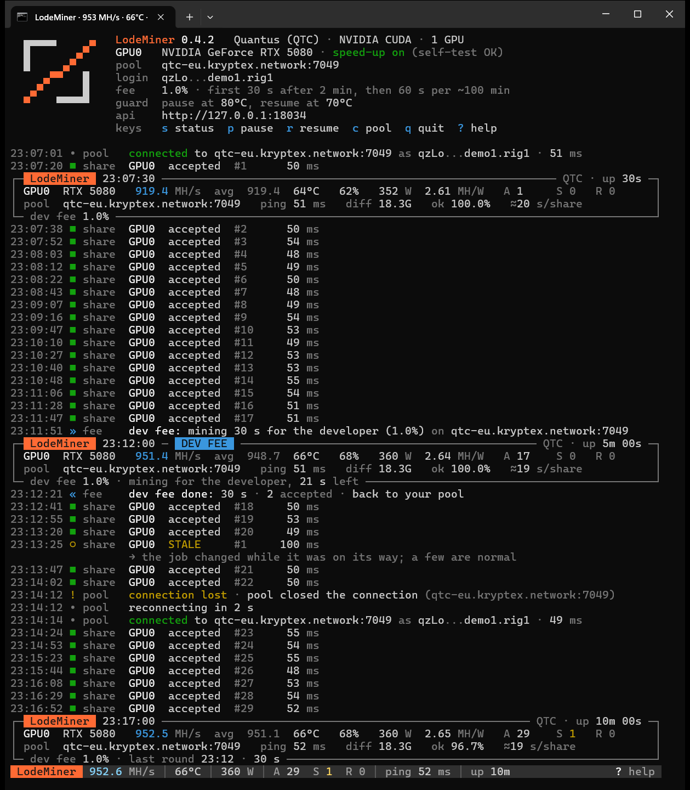
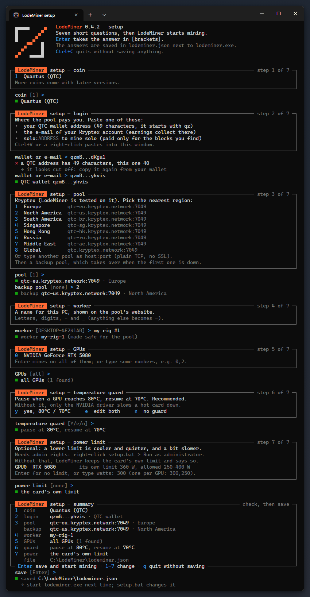

<p align="center">
  <picture>
    <source media="(prefers-color-scheme: dark)" srcset="assets/lodeminer-banner-anim-dark.gif">
    
  </picture>
</p>

<p align="center">
  <b>Fast, transparent cryptocurrency miner for NVIDIA GPUs.</b>
</p>

<p align="center">
  <a href="https://github.com/Lyrnc/LodeMiner/releases/latest"></a>
  <a href="https://github.com/Lyrnc/LodeMiner/releases"></a>
  
  
  
  <a href="https://discord.gg/pPqay7xvUZ"></a>
</p>

<p align="center"></p>

## Why LodeMiner

- **Fast.** ~950 MH/s on quantus with a stock RTX 5080.
- **Low, visible fee.** 1%, printed at start-up and shown during every dev-fee round. No hidden mining.
- **Clean shares.** Every share is checked on the CPU before it is sent, so bad results never reach your pool.
- **Safe to leave running.** Optional temperature limit with automatic pause and resume (on by default in
  `setup.bat` and the included `start.bat`). Nothing changes your card's settings unless you ask for it.
- **No surprises.** No silent updates, no telemetry.

## Download

The first public release is coming soon. Click **Watch** at the top of this page, then **Custom** > **Releases**,
to get a notification when it's out.

Only download LodeMiner from this page's [Releases](https://github.com/Lyrnc/LodeMiner/releases). Each release lists
the SHA-256 of its files.

## Algorithms

| Algorithm | Coin | Fee |
|---|---|---|
| `quantus` | Quantus (QTC) | 1.0% |

More algorithms are on the way.

## Hashrate

| GPU | quantus | Power |
|---|---|---|
| RTX 5080 | ~950 MH/s | ~370 W |

Stock clocks and power limit, monitor not connected to the mining card. Got another card?
[Send a hashrate report](https://github.com/Lyrnc/LodeMiner/issues/new?template=hashrate_report.yml) and it goes in
this table.

## Supported GPUs and systems

| | |
|---|---|
| GPUs | NVIDIA: RTX 50 (Blackwell), RTX 40 (Ada), RTX 30 (Ampere), RTX 20 / GTX 16 (Turing) |
| Driver | 576.02 or newer |
| Systems | Windows 10 / 11 (64-bit). Linux and HiveOS: coming soon |

## Quick start

**New to mining:** download and unzip the latest release, then double-click `setup.bat`. It asks a few short
questions (wallet or Kryptex email, pool region, rig name, GPUs, temperature limit), saves them and starts mining.
Next time, just start `lodeminer.exe`. Run `setup.bat` again to change anything.

<p align="center"></p>

**Know your way around miners:** edit the included `start.bat` (one commented command line, like other miners'
start files) or use one of the ready files in `examples\`. From a terminal:

```bat
.\lodeminer.exe -a quantus -o qtc-eu.kryptex.network:7049 -u YOUR_WALLET -w rig1
```

<details>
<summary><b>Kryptex account (email login, no wallet needed)</b></summary>

```bat
.\lodeminer.exe -a quantus -o qtc-eu.kryptex.network:7049 -u you@example.com -w rig1
```

</details>

<details>
<summary><b>Failover pools</b></summary>

Give several pools separated by commas. LodeMiner moves to the next one when a pool stops answering.

```bat
.\lodeminer.exe -a quantus -o POOL_A:PORT,POOL_B:PORT -u YOUR_WALLET -w rig1
```

</details>

<details>
<summary><b>Config file</b></summary>

```json
{
  "algorithm": "quantus",
  "pool": ["qtc-eu.kryptex.network:7049", "qtc-us.kryptex.network:7049"],
  "wallet": "YOUR_WALLET",
  "worker": "rig1",
  "gpu-temp-limit": 80,
  "api-port": 4068
}
```

```bat
.\lodeminer.exe --config lodeminer.json
```

Save it as `lodeminer.json` next to `lodeminer.exe` and just start `lodeminer.exe`, or point to any file with
`--config`. Command-line options override the file. `lodeminer.exe --help` lists every option.

</details>

## Options you will use most

| Option | What it does |
|---|---|
| `-o`, `--pool` | Pool `host:port`, comma-separated for failover |
| `-u`, `--wallet` | Wallet address or Kryptex account email |
| `-w`, `--worker` | Rig name shown on the pool |
| `--gpu-id 0,2` | Mine only on these GPUs (see `--list-devices`) |
| `--gpu-temp-limit 80` | Pause at this temperature, resume after cooling down (`--gpu-temp-resume`); off unless set |
| `--gpu-plimit 300` | Power limit in watts (needs administrator) |
| `--gpu-fan 70` | Fan speed in percent (needs administrator) |
| `--api-port 4068` | Read-only JSON stats at `http://127.0.0.1:4068/summary` |
| `--log-file miner.log` | Also write the log to a file |

## Hotkeys

| Key | Action |
|---|---|
| `s` or `h` | Show the status panel now |
| `p` | Pause mining |
| `r` | Resume mining |
| `c` | Pool connection details |
| `?` | Help |
| `q` | Quit, with a short session summary |

## FAQ

<details>
<summary><b>My antivirus flags lodeminer.exe</b></summary>

Antivirus programs flag almost every crypto miner, because malware often bundles miners. Download LodeMiner only
from this page, check the SHA-256 against the release notes, and add an exclusion for the LodeMiner folder if you
trust it.

</details>

<details>
<summary><b>How does the dev fee work?</b></summary>

1% of mining time goes to the developer: a first 30 seconds after 1 to 2 minutes of mining, then 60 seconds per
~100 minutes. It uses your own pool when possible, and the console shows every round as it starts and ends, plus when
the last one was. LodeMiner remembers the fee time across restarts in a small file, so a restart picks up where it
left off instead of starting over. Pausing or a temperature pause doesn't count as mining time.

</details>

<details>
<summary><b>My hashrate is lower than the table</b></summary>

A monitor plugged into the mining card, video playback, games or a browser on the same GPU take a few percent.
Old drivers can be slower too: use 576.02 or newer.

</details>

## Support

- Discord: [join our community](https://discord.gg/pPqay7xvUZ)
- Bugs: [open a bug report](https://github.com/Lyrnc/LodeMiner/issues/new?template=bug_report.yml)
- Hashrate on your card: [send a hashrate report](https://github.com/Lyrnc/LodeMiner/issues/new?template=hashrate_report.yml)
- Security issues: see [SECURITY.md](SECURITY.md)

## License

Free to use, not open source. See [LICENSE](LICENSE). Built on
[quantus-miner](https://github.com/Quantus-Network/quantus-miner) (Apache 2.0, see [NOTICE](NOTICE)) and other
open-source libraries; their licenses ship in the download.
